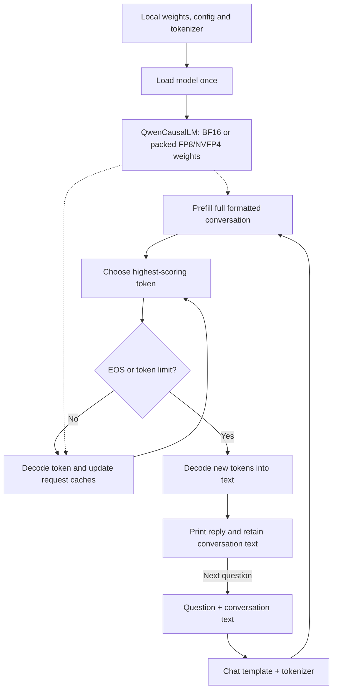

# Architecture walkthrough

This describes the implementation reviewed on 2026-11-14: native inference
checkpoint `47cf4cbc`, with the CLI checkpoint `a9e75e6`. It explains the current
code; it is not a performance report. No inference code was changed for this
walkthrough.

## What you built

The engine reads a trained model's numerical weights, turns your text into
token IDs, computes scores for possible next tokens, and repeatedly chooses
the highest-scoring token. PyTorch executes the tensor operations on CUDA.

The trained weights supply the learned behavior. This repository supplies the
model execution logic and generation loop. Transformers/Tokenizers supply text
encoding, decoding and chat-template rendering; they do not run the Qwen model's
forward pass or generation. Ollama was a validation reference and is not needed
to run the native CLI.

There are three distinct kinds of memory:

| Data | Owner | Lifetime |
| --- | --- | --- |
| Model weights | The loaded `QwenCausalLM` | The CLI session |
| Conversation text | The CLI's list of role/content messages | Until reset or exit |
| KV/recurrent/convolution state | One call to `QwenCausalLM.generate` | One generated reply |

**Keeping the model loaded does not mean reusing its token cache between chat
turns.** Each new question formats and prefills the entire conversation again.
Within one reply, cached decoding avoids recomputing that prefix for every
generated token.

## Follow one question through the system



1. **Choose and load the model.** The CLI detects a supported Safetensors
   directory or GGUF file and creates a text adapter around a native model.
2. **Prepare the prompt.** `NativeQwenText.chat` renders role markers and the
   model's chat template, then produces token IDs. The adapter currently sets
   `enable_thinking=False` and moves the IDs to the model's device.
3. **Prefill.** `QwenCausalLM.prefill` processes all prompt tokens, produces
   vocabulary scores (logits), and returns one cache entry per layer.
4. **Select a token.** `generate` takes the last position's logits and uses
   `argmax`, the highest-scoring vocabulary entry. There is no sampling here.
5. **Decode.** If generation continues, `decode` feeds that selected token
   through the layers using their saved state. It produces the next scores.
6. **Finish.** An end-of-sequence (EOS) token or the new-token limit ends
   generation. The adapter decodes only the newly generated IDs. The CLI stores
   the successful user/reply pair.

`generate_text` follows the same native generation path, using raw text without
the conversation template. The CLI supports one request at a time. It has no
request scheduler, HTTP server or continuous batching system.

## Source map

| File | Responsibility / entry points |
| --- | --- |
| [__main__.py](spark_engine/__main__.py) | `python -m spark_engine` entry point |
| [cli.py](spark_engine/cli.py) | Model selection, `_chat` history, commands, cancellation and presentation |
| [qwen_text.py](spark_engine/qwen_text.py) | `NativeQwenText`: offline tokenizer/template and native text APIs |
| [qwen_model.py](spark_engine/qwen_model.py) | `QwenCausalLM`: loading, embeddings, layers, `prefill`, `decode`, `generate` |
| [qwen_layers.py](spark_engine/qwen_layers.py) | Decoder layer, full attention, gated delta network, MLP and normalization dispatch |
| [qwen_ops.py](spark_engine/qwen_ops.py) | Normalization, partial RoPE and FP32/chunked delta-rule arithmetic |
| [qwen_gguf.py](spark_engine/qwen_gguf.py) | GGUF metadata/tensors, dequantization, layout restoration, tokenizer and loader |
| [qwen_quantized.py](spark_engine/qwen_quantized.py) | Strict streaming reader, meta construction, packed linear replacement and complete tensor coverage |
| [qwen_nvfp4.py](spark_engine/qwen_nvfp4.py) | NVFP4 block-scale layout, packed weight buffers and FlashInfer/CUTLASS quantized GEMM |
| [qwen_fp8.py](spark_engine/qwen_fp8.py) | Per-token FP8 activation scaling, channel-scaled weight buffers and PyTorch scaled_mm |
| [qwen_config.py](spark_engine/qwen_config.py) | Standalone parser that unwraps a nested text config; current loaders also build their own native config |
| [model.py](spark_engine/model.py), [ops.py](spark_engine/ops.py) | Separate Llama baseline and its tensor operations |

The Qwen CLI and the Llama completion CLI use separate native model classes.
Explicit `--architecture` selection chooses a compatible implementation; it
does not add support for an arbitrary Hugging Face architecture.

## How weights become a ready model

### 9B Safetensors

`NativeQwenText.from_pretrained` calls `QwenCausalLM.from_pretrained` and loads
the local fast tokenizer.

The model loader unwraps the text configuration, constructs a model with CPU
FP32 parameters, then converts/moves it to the requested dtype/device. The
validated Qwen CLI requests CUDA BF16. It reads the Safetensors shard index,
loads one shard at a time, maps matching text parameter names, and copies
weights into the model. It checks that all required native parameters loaded.
Visual/MTP prefixes are excluded from the text path.

The CPU construction happens before checkpoint loading and its initialized
values are overwritten. This startup path can need substantially more memory
than the final BF16 weights alone. It is different from the 27B meta-device
construction below.

### 27B Q8_0 GGUF

`load_qwen_gguf` reads the actual file's metadata and tensor directory, derives
the native config, and constructs a tokenizer from the embedded vocabulary,
merges, token flags and chat template.

The native model is first constructed on PyTorch's **meta device**: parameter
shapes exist without allocating their weight storage. The loader sets BF16
parameter dtype before allocating the final CUDA storage with `to_empty`.

It then reads tensor payloads sequentially:

1. Decode supported F32/BF16/Q8_0 storage into CPU FP32 values.
2. Map the GGUF name and restore its native shape/value conventions.
3. Undo the exported linear-attention value-head ordering using config-derived
   head counts. This covers V rows, gates, decay parameters, convolution
   channels and output columns while preserving the Q/K prefix.
4. Cast/copy into the corresponding CUDA BF16 parameter with gradients disabled.
5. Release the main source tensor, then verify complete native-key coverage at
   the end and return the shared text adapter.

Restoration includes normalization offsets, converting the stored negative
decay scale back to `A_log`, and restoring the depthwise-convolution dimension.
Getting names and shapes right alone was insufficient: value-head order had
to match the native computation to obtain correct real-model output.

**Q8_0 is currently an input storage format.** The engine expands its weights
to BF16 and executes ordinary PyTorch operations. It does not perform native
Q8_0 matrix multiplication. A 27-billion-parameter BF16 model would use roughly
54 GB (50 GiB) for weights alone; this arithmetic is not a measured peak.
CPU staging arrays/views, GPU transfer temporaries, request state and allocator
reservations add to the total.

On the development Spark, CPU and GPU allocations share physical memory.
Include both kinds of allocation in the budget, and count the machine's
physical capacity once. A model's file size is not its runtime memory budget.

## What happens inside a decoder layer

Both Qwen models alternate two kinds of token-mixing layer. Their reviewed
checkpoint configurations are:

| Text-model property | Downloaded 9B Safetensors | Downloaded 27B GGUF |
| --- | --- | --- |
| Hidden width | 4096 | 5120 |
| Decoder layers | 32 | 64 |
| Linear-attention / full-attention layers | 24 / 8 | 48 / 16 |
| Full-attention query / KV heads | 16 / 4 | 24 / 4 |
| Full-attention head width | 256 | 256 |
| Linear-attention key / value heads | 16 / 32 | 16 / 48 |
| Linear-attention key / value head width | 128 / 128 | 128 / 128 |
| Convolution kernel length | 4 | 4 |

The 9B loader uses its explicit layer-type list; the 27B loader derives full
attention every fourth layer from the GGUF metadata. These numbers describe
the two tested checkpoints, not every model in their families.

Each `QwenDecoderLayer` performs:

```text
hidden -> normalization -> token mixer -> add original hidden
       -> normalization -> gated feed-forward MLP -> add residual
```

The MLP uses three linear projections with SiLU gating. The residual additions
carry the incoming representation alongside each computed update. After all
layers, final normalization and `lm_head` turn hidden vectors into vocabulary
scores.

### Full attention: look back through stored keys and values

`QwenAttention` projects queries, keys, values and a query-output gate. It
normalizes Q/K, applies partial rotary position encoding (RoPE), computes
attention scores with matrix multiplication and softmax, gates the result,
and projects it back to the hidden width.

During prefill, a causal mask prevents a prompt position from looking ahead.
During single-token decode, previous K/V tensors are concatenated with the new
K/V. Grouped-query attention repeats KV heads for computation, while the cache
stores the smaller KV-head representation.

### Gated delta network: carry a recurrent summary

`QwenGatedDeltaNet` projects Q/K/V and processes them with a depthwise causal
convolution. Learned gates control how a recurrent matrix retains and updates
information. Gated normalization and an output projection produce the update
to the layer's hidden representation.

For BF16 prefill without an initial state, `gated_delta_rule` selects the
chunked path, with a default chunk size of 64 and FP32 triangular solves/state
arithmetic. Cached decode selects the recurrent path. Normalizations,
attention softmax and recurrent calculations use FP32 where the source
explicitly casts; BF16 weights do not mean every intermediate is BF16.

## Request state and conversation history

Here `B` is batch size, `T` cached token count, and head dimensions come from
the config. The CLI uses `B=1`.

| Layer / state | Representation | Growth during one generated reply |
| --- | --- | --- |
| Full-attention KV | Tuple of K/V tensors, each `[B, KV heads, T, head width]` | Grows with token count |
| Delta recurrent state | FP32 tensor `[B, value heads, key width, value width]` | Fixed shape |
| Delta convolution state | Tensor `[B, convolution channels, kernel length]` | Fixed shape |
| Delta position tracking | Integer `length` in its cache dict | Increments per decoded token |

`prefill` creates the per-layer cache list. `decode` updates that list and uses
cached length to determine the next position. `generate` owns the list for
one call. There is no persistent cross-turn cache or shared prefix cache.
PyTorch may keep freed allocations reserved for reuse after a request; model
tensor size and allocator-reserved memory are different measurements.

The CLI retains strings, including an optional system message. On the next
turn, `NativeQwenText.chat` renders those strings plus the new question and
starts a fresh native generation request. `/reset` discards the conversation
strings but keeps the configured system message and loaded weights. A cancelled
turn is not appended to successful history. Replies print after completion.

## What PyTorch provides and what this project provides

| This project | PyTorch and text libraries |
| --- | --- |
| Architecture, parameter mapping and GGUF restoration | Tensor storage, dtype/device conversion and the CUDA allocator |
| Layer composition, normalization formulas, attention and delta-rule logic | Matrix multiplication, convolution, reductions, activations and triangular solve implementations |
| Cache layout, request positions, greedy loop and EOS handling | Dispatch of tensor operations to available CUDA kernels |
| CLI/session policy and which template/tokenizer to use | Fast BPE tokenization, chat-template rendering and text decoding |

`eval()` and `torch.inference_mode()` select inference behavior for the text
APIs. The project is not training these models during chat. It currently has
no custom CUDA/Triton kernels, `torch.compile` integration, CUDA-graph capture,
explicit memory-budget manager or multi-Spark executor.

## Findings to measure in the next phase

These are observations from source, not ranked performance findings. No speed
or memory benchmark was run for this walkthrough.

| Observed behavior | Measurement it motivates |
| --- | --- |
| Whole conversation is prefilled again each turn | Prefill latency versus conversation length; potential cross-turn state reuse |
| Full-attention prefill materializes score matrices and a dense causal mask | Prompt-length scaling and peak temporary memory |
| Prefill produces vocabulary logits for all prompt positions | Output-head time and `[B, prompt length, vocabulary]` memory |
| Attention decode concatenates growing KV tensors, including separate concatenations for returned caches | Copy/allocation time per generated token |
| Delta prefill computes the QKV projection again to construct convolution state | Projection time and possible reuse |
| RoPE frequencies and positions are rebuilt for each decode | Per-token setup overhead |
| The greedy loop decodes even after its final length-limited token, unless EOS breaks first | Cost of the final unused next-logit computation |
| 9B CPU FP32 initialization and GGUF FP32 staging precede usable BF16 weights | Separate cold-load time, peak host/device allocation and steady-state memory |
| Python generation/chunk loops and many separate tensor operations | CPU launch overhead versus CUDA operator time |

Choose an optimization after measurement, keep the existing numerical gates,
and have the local model implement inference changes. Longer output, batching,
sampling and persistent chat caches require their own correctness coverage.

## Validation and reproducibility

The 2026-11-14 development experiment reported:

- **56 Qwen gates:** a mixture of diagnostics, tiny numerical/runtime/storage
  checks, tokenizer/layout checks and actual-checkpoint checks.
- **Actual 9B:** CUDA BF16 logits matched the reference with the original
  `rtol=0.05, atol=0.05`; the tested greedy token sequence matched exactly.
  Raw text and a short two-turn conversation also passed.
- **Actual 27B:** native greedy output matched the reference continuation;
  raw text and two conversation replies matched the independent reference
  exactly, with at most eight new tokens per call.
- **15 Llama baseline cases:** remained passing. These include the offline CLI.
- **CLI checkpoint:** 16 portable tests plus actual 9B/27B subprocess sessions
  that each exercised two turns and reset/repeat without reloading the model.

For example, the actual 27B replied `Hello!` to `Say hello briefly.`, then
`You asked me to say hello briefly.` to the follow-up question.

The [CLI tests](tests/test_cli.py) are in this repository. The original CUDA
acceptance harness, golden tensors, model checkpoints and complete experiment
logs live outside the repository on the development machine:

```text
/home/cap/spark-inference-overnight-20261113/feedback/native-text-completion-audit.json
/home/cap/spark-inference-overnight-20261113/feedback/cli-validation.json
/home/cap/spark-inference-overnight-20261113/acceptance/
```

Those external artifacts are needed to reproduce the full acceptance run;
cloning this repository alone does not reproduce all 56 gates. Short greedy
checks establish the stated behavior, not broad model quality, long-context
reliability, throughput or latency. Vision/video, MTP/speculative decoding,
other quantizations and non-greedy sampling remain unvalidated.

The original [component map](INFERENCE_ENGINE_DIAGRAM.txt) is preserved as a
roadmap. Its scheduler, registry, memory manager, streaming/API and distributed
components describe intended work, not implemented subsystems. The local model
wrote the native inference code; Codex wrote the directly authorized CLI and
this source-based walkthrough.

## Downloaded mixed NVFP4/FP8 checkpoint

The additional Unsloth Qwen3.8-27B Safetensors path enters through the same
NativeQwenText and QwenCausalLM public factory. Nonempty quantization metadata
dispatches to qwen_quantized.load_quantized_qwen. The existing unquantized9B and
GGUF paths retain their original arithmetic and loading behavior.

The quantized loader creates the text architecture on meta, replaces supported
linear layers with packed-weight modules and transfers one tensor at a time.
Missing, unexpected, duplicate or incorrectly shaped text tensors fail closed.
This avoids allocating a full CPUFP32 or GPU BF16 copy of the27B model. The
downloaded recipe uses168NVFP4 and233FP8 linear modules; its actual resident
tensor storage is22,586,157,376bytes, approximately21.04GiB.

BF16 hidden states enter each quantized linear. NVFP4Linear packs activations
using calibrated global scales and calls FlashInfer/CUTLASS on packed4-bit
weights and block scales. FP8Linear computes per-token activation scales and
calls PyTorch scaled_mm with FP8 weights and per-output-channel scales. Outputs
return to BF16 for the existing native layer/residual logic. These are primitive
GPU kernels; no external serving engine supplies the model forward or generation.

Full-attention KV cache remains BF16; Gated DeltaNet request state retains its
existing precision/ownership. Source FP8 KV-calibration tensors are explicitly
skipped, as are vision and MTP tensors. No claim covers all NVFP4 conversion
recipes, other architectures, speculative decoding or long-context reliability.
The supported runtime is the locally pinned GB10 image documented in the
guarded chat launcher. The older BF16 agent image lacks the required FlashInfer
dependency. Model data remains external and read-only.

Independent tiny operators and a sequential tiny reference/native hybrid model
passed, followed by actual27B short greedy-reference and two-turn conversation
checks. All56protected Qwen gates and15Llama cases passed after integration,
without numerical tolerance changes. See [native validation](benchmarks/results/2026-11-14-native-nvfp4/README.md)
and the [checkpoint manifest](benchmarks/model-manifests/qwen38-27b-nvfp4.json).
